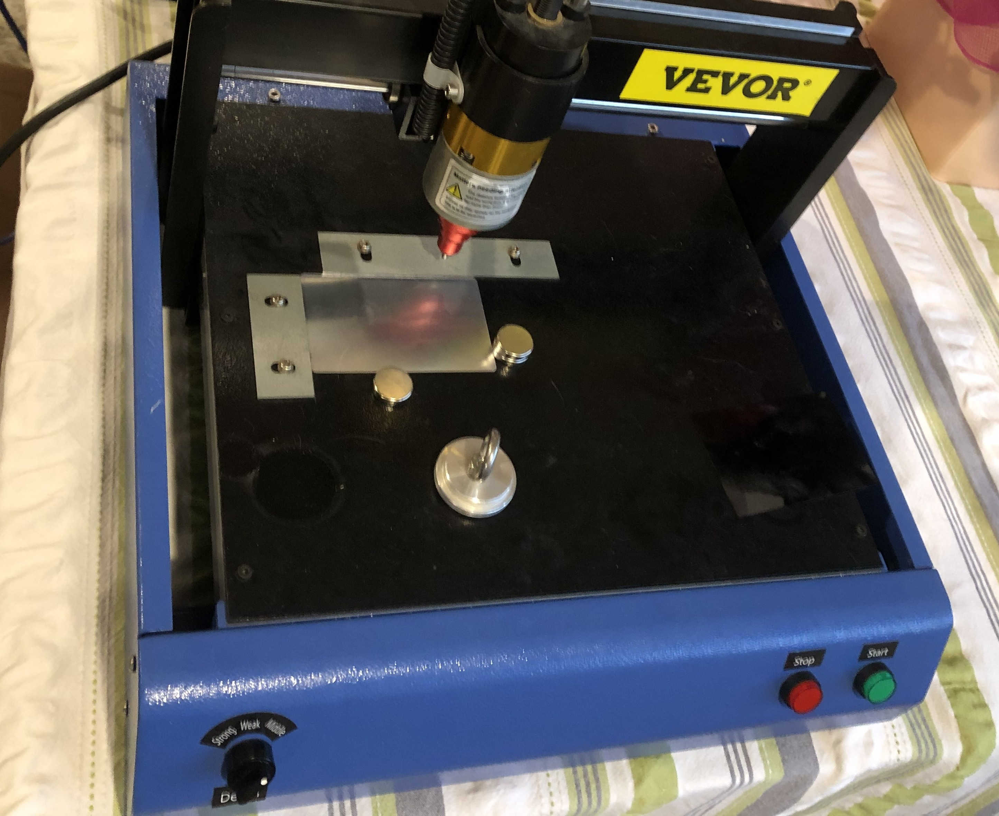
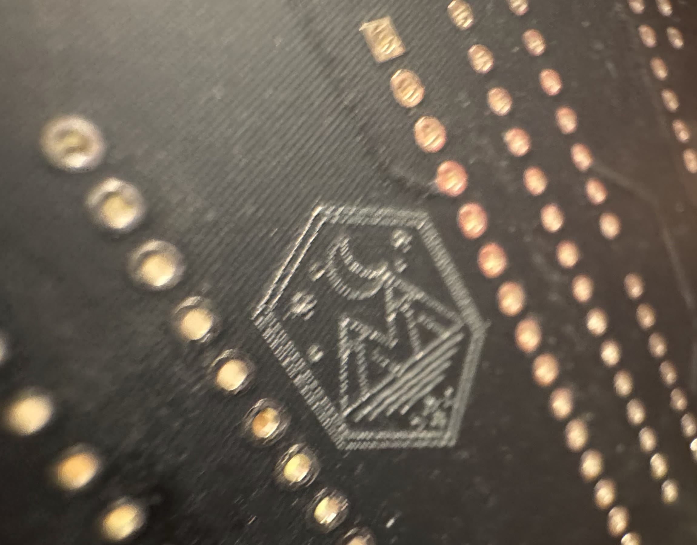
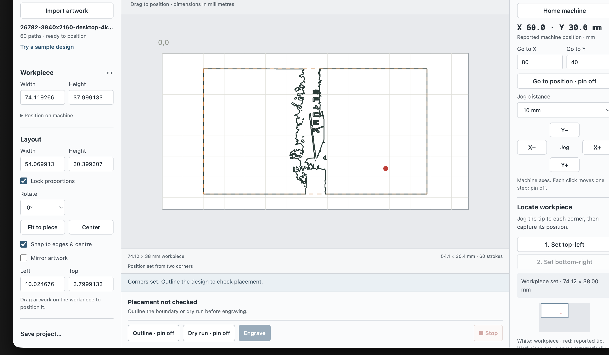

# Mark Studio

<p align="center">
  
  
</p>

An offline desktop app for preparing artwork and controlling compatible VEVOR / ThorX6-style USB dot-peen engravers. The VEVOR 400 W machine shown above is the hardware used to validate Mark Studio. It imports line art, locates a workpiece from two corners, previews placement with the pin off, and marks one pass only after a matching preview.

<p align="center">
  
</p>

This project is independent and is not affiliated with or endorsed by VEVOR. Compatible hardware includes VEVOR's official [200 × 150 mm](https://www.vevor.com/marking-machine-c_10477/400w-electric-metal-marking-engraving-machine-200x150mm-50mm-s-nameplate-110v-us-p_010564478831) and [300 × 200 mm](https://www.vevor.com/marking-machine-c_10477/vevor-400w-electric-dot-peen-marking-machine-300x200mm-50mm-s-serial-number-code-p_010594104012) 400 W dot-peen machines. Confirm your own machine's travel before use.

## Download

Download the latest macOS, Windows, Linux, or source package from the repository's **Releases** tab.

## Use

1. Connect the powered-on engraver by USB. Mark Studio reconnects automatically when it finds one compatible FTDI device.
2. Import SVG, PNG, JPG, or WebP artwork and set the workpiece dimensions. For the most reliable results, use clean black-on-white line art.
3. Jog to the top-left and bottom-right corners to locate the workpiece. Use **Outline workpiece** or **Outline design** with the pin off to check placement.
4. The machine's physical Start button uses a deliberate sequence: first press homes, second press outlines, third press engraves. Release it for one second between actions. The red physical Stop button remains the emergency control.

## Safety

The app can move and mark a physical machine. Keep the carriage path clear, clamp the workpiece, set the tip gap, and verify the outline before engraving. Homing, stopping, disconnecting, or changing the layout requires a fresh preview.

## Build from source

Requires Node.js 22.12 or newer.

```sh
npm ci
npm run check
npm run check:artwork
npm start
```

Package for a platform with `npm run build -- darwin arm64`, `npm run build -- win32 x64`, or `npm run build -- linux x64`.

## Compatibility

Mark Studio supports the tested ThorX6-compatible XY dot-peen protocol over the FTDI USB serial controller. It is not GRBL, laser, or rotary-machine software. The default travel values are conservative; calibrate travel and steps in Machine settings for a different machine.

## License

[MIT](LICENSE)
